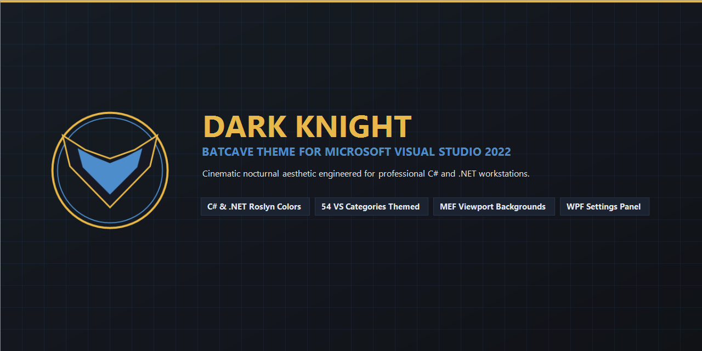

# Dark Knight — Gotham Dark Theme for Visual Studio

<p align="center">
  
</p>

<p align="center">
  <strong>A premium, cinematic Batman-inspired dark theme for Microsoft Visual Studio 2022.</strong><br/>
  Featuring a distinctive Batcave workstation aesthetic optimized for professional C# and .NET development, with an optional non-intrusive editor background system.
</p>

<p align="center">
  
  
  
  
  
</p>

---

## Overview

**Dark Knight** transforms Visual Studio 2022 into a sophisticated Batcave workstation. Engineered for professional .NET developers, it replaces standard high-glare surfaces with a balanced near-black charcoal foundation, deep graphite tool windows, muted Batman gold accents, and electric Gotham blue highlights.

This is a **genuine Microsoft Visual Studio Extension (VSIX)** built with the official Visual Studio SDK, not a Visual Studio Code port. It delivers:

1. **Full IDE Theme Coverage:** 54 Visual Studio categories styled natively via compiled `.pkgdef` and `.vstheme` resources.
2. **Professional C# & .NET Roslyn Highlighting:** Accessible semantic colorization with high WCAG AA/AAA contrast ratios.
3. **Optional MEF Editor Background System:** Subtle Batcave workstation watermarks rendered behind code via official WPF editor APIs (`IWpfTextViewCreationListener`), with adjustable opacity and a dark tint shield.
4. **Interactive Settings Interface:** Full configuration panel hosted both under **Tools > Options** and as a dedicated dockable **Tool Window**.
5. **Original UI Assets:** Bespoke nocturnal vigilante branding, abstract emblem, status bar icon, tool window icon, surface texture, and 4 procedural background themes.

---

## Marketplace Banner & Showcase



### 1. Code Editor & Professional C# Syntax

*High-contrast C# 12 / .NET code editor: Keywords in Gotham blue (`#4D8DCC`), types in syntax cyan (`#42D9D0`), methods in soft blue (`#61AFEF`), strings in muted gold (`#E7B45A`), numbers in lavender (`#C678DD`), and comments in muted green (`#7F9B8A`).*

### 2. Solution Explorer & Batcave Tool Windows

*Unified dark framing: Active tab featuring a Batman gold accent bar, secondary graphite tool windows (`#171C25`), and distinct selection states.*

### 3. IntelliSense & Signature Help

*IntelliSense completion lists, Quick Info tooltips, and parameter info boxes rendered with crisp contrast.*

### 4. Interactive Debugging & Breakpoints

*Active execution pointer in emerald green (`#55D6A0`), breakpoint line highlight in deep burgundy (`#3B1D22`), Gotham blue status bar indicator, and Watch/Locals panels.*

### 5. Error List & Diagnostic Waves

*Accessible diagnostic colors: Clear red (`#FF626B`) for compiler errors, warm amber (`#E8B84A`) for warnings, and Gotham blue for suggestions.*

---

## Color Palette & Design System

The Dark Knight palette is carefully calibrated to prevent eye fatigue during marathon coding sessions while meeting or exceeding **WCAG 2.1 AA/AAA** accessibility standards:

| Role | Hex | Purpose / IDE Element |
| :--- | :--- | :--- |
| **Editor Canvas** | `#101216` | Main editor canvas, document well background, terminal background |
| **Tool Window Background** | `#171C25` | Solution Explorer, Git Changes, Error List, Output window |
| **Secondary Surface** | `#1C2330` | Title bar, tab well backdrop, menus, borders, dialog cards |
| **Primary Text** | `#E6EAF0` | Soft white: Plain text, local variables, operators, punctuation |
| **Muted Text** | `#929BA8` | Cool gray: Inactive tab text, tool window labels, line numbers |
| **Accent Gold** | `#E8B84A` | **Batman Gold**: Active tab accent bar, cursor, warning indicators |
| **Accent Blue** | `#4D8DCC` | **Gotham Blue**: C# keywords, primary buttons, focus frames |
| **Syntax Cyan** | `#42D9D0` | Classes, record structs, enums, interfaces, generic types |
| **String Color** | `#E7B45A` | Muted gold: String literals, verbatim strings, CSS values |
| **Comment Color** | `#7F9B8A` | Muted green-gray: Code comments and XML doc text |
| **Error Color** | `#FF626B` | Clear red: Compiler diagnostics, error waves, breakpoint glyphs |
| **Success Color** | `#55D6A0` | Emerald green: Execution statement pointer, Git additions, build success |
| **Active Selection** | `#1B385C` | Deep Gotham navy: High-contrast selection background |
| **Inactive Selection** | `#162C46` | Unfocused text selection background |

---

## Optional Editor Background System

The background watermark system is implemented as a **separate, non-intrusive MEF editor extension** that complements the theme. Background images are optional decorative assets and **never substitute for theme colors**; the editor remains 100% usable without them.

### Safety & Usability Architecture:
- **Strict Z-Ordering:** Injected via an `IAdornmentLayer` ordered `Before = PredefinedAdornmentLayers.Text`. Code text, selection geometry, carets, breakpoints, squiggles, and IntelliSense windows render physically in front.
- **Hit-Test Transparent:** All background visual elements have `IsHitTestVisible = false`. Mouse clicks, dragging, selection, and margin clicks pass straight to the editor with zero interference.
- **Dual-Layer Contrast Shield:** A dark translucent tint overlay (`#101216` at 70%) sits between the watermark image and the text layer.
- **Readability Defaults:** Backgrounds are **disabled by default**, and feature a very low opacity (8%) when enabled.

### 4 Original Background Presets:
1. **Batcave Mainframe:** Terminal diagnostics, holographic HUD, circular radar crosshairs, and hex grid telemetry in Gotham blue and gold.
2. **Gotham Skyline:** Nocturnal cityscape silhouette featuring art-deco towers, spires, and dual searchlights sweeping night clouds.
3. **Gargoyle Vigil:** Architectural gargoyle perched on a Gothic stone ledge overlooking misty Gotham below.
4. **Batmobile Tech Grid:** Tactical vehicle CAD blueprint schematics, dimensional callouts, and Wayne Enterprises telemetry.
5. **Custom Image:** Support for loading any local `.png`, `.jpg`, or `.bmp` file.

---

## Settings Interface

Customize the Batcave background in real time through two official Visual Studio interfaces:

1. **Tools > Options:** Navigate to **Tools > Options > Dark Knight Theme > Batcave Background**.
2. **Dockable Tool Window:** Open **View > Other Windows > Dark Knight — Batcave Background Settings**.

### Configurable Controls:
- **Enable/Disable Toggle:** Instant master switch for editor watermarks.
- **Visual Preset Selector:** 4 graphical thumbnail cards for one-click preset switching.
- **Custom Image Picker:** File browser to load your own image.
- **Image Opacity Slider:** Fine-tune watermark intensity from 1% to 35% (default 8%).
- **Dark Tint Overlay Slider:** Adjust the contrast shield between 0% and 95% (default 70%).
- **Positioning & Scaling:** Choose **BottomRight** (recommended), **Center**, or **UniformToFill**.
- **Reset to Defaults:** One-click restoration of clean baseline settings.
- **Real-Time Synchronization:** Settings changes instantly broadcast to all open editor tabs without restarting Visual Studio.

---

## Installation

### Method 1: Pre-Built VSIX Package (Recommended)
1. Close running instances of Microsoft Visual Studio 2022.
2. Open `dist\DarkKnightTheme.vsix`.
3. Select your Visual Studio 2022 installation (Community, Professional, or Enterprise) and click **Install**.
4. Launch Visual Studio 2022.

### Method 2: Command-Line Installation via VSIXInstaller
```powershell
& "C:\Program Files\Microsoft Visual Studio\2022\Community\Common7\IDE\VSIXInstaller.exe" dist\DarkKnightTheme.vsix
```

### Method 3: Automated Build from Source
```powershell
.\build\build.ps1
```
The automated script validates prerequisites, regenerates all background and branding graphics, compiles the `.vstheme` into binary `.pkgdef`, runs MSBuild with `CreatePkgDef`, and outputs `dist\DarkKnightTheme.vsix`.

---

## Activating the Theme

After installation, activate Dark Knight in Visual Studio:

1. Click **Tools** in the top menu bar.
2. Select **Theme > Dark Knight**.

*Alternatively:*
1. Go to **Tools > Options**.
2. Navigate to **Environment > General**.
3. Under **Color theme**, select **Dark Knight** from the dropdown.
4. Click **OK** to apply.

---

## Project Structure

```
bold-lovelace/
├── DarkKnightTheme.sln                   # Visual Studio 2022 Solution
├── dist/
│   └── DarkKnightTheme.vsix             # Distributable VSIX Package (451 KB)
├── src/
│   └── DarkKnightTheme/
│       ├── DarkKnightTheme.csproj       # VSIX & MEF Project File
│       ├── source.extension.vsixmanifest# VSIX v2 Manifest (AMD64, VS 2022)
│       ├── DarkKnightPackage.cs         # AsyncPackage Entry Point
│       ├── DarkKnight.vstheme           # XML Source Theme Definition (54 Categories)
│       ├── DarkKnight.pkgdef            # Compiled Binary Theme Package Definition
│       ├── LICENSE.txt                  # MIT License & Trademark Notice
│       ├── Background/
│       │   ├── DarkKnightBackgroundAdornmentLayer.cs    # MEF Adornment Definition
│       │   ├── DarkKnightBackgroundCreationListener.cs # IWpfTextViewCreationListener
│       │   └── DarkKnightBackgroundAdornment.cs       # Viewport Watermark & Overlay
│       ├── Settings/
│       │   └── DarkKnightSettings.cs    # Settings Model & JSON Persistence
│       ├── UI/
│       │   ├── DarkKnightSettingsControl.xaml         # WPF Settings Panel
│       │   ├── DarkKnightSettingsControl.xaml.cs      # UI Code-Behind
│       │   ├── DarkKnightSettingsPage.cs              # Tools > Options DialogPage
│       │   └── DarkKnightSettingsToolWindow.cs        # Dockable ToolWindowPane
│       └── Resources/
│           ├── Icon.png                 # 128x128 Extension Icon
│           ├── Preview.png              # Marketplace Hero Preview
│           ├── statusbar_icon.png       # 16x16 Status Bar Icon
│           ├── toolwindow_icon.png      # 16x16 Tool Window Icon
│           ├── dark_texture.png         # 64x64 Seamless Texture
│           └── Backgrounds/             # 4 Full-Res Backgrounds + Thumbnails
│               ├── batcave_mainframe.png & thumb
│               ├── gotham_skyline.png & thumb
│               ├── gargoyle_vigil.png & thumb
│               └── batmobile_techgrid.png & thumb
├── assets/
│   ├── icon_256.png                     # High-Resolution 256x256 Icon
│   ├── emblem.png                       # Gold & Blue Abstract Vigilante Emblem
│   ├── marketplace_banner.png           # 1280x640 Marketplace Banner
│   └── screenshots/                     # 5 High-Resolution Showcase Previews
├── build/
│   ├── build.ps1                        # Master Build Script
│   ├── generate_theme.ps1               # Theme XML & PKGDEF Compiler
│   ├── generate_backgrounds.ps1         # Original Background Artwork Generator
│   └── generate_graphics.ps1            # Icon & Preview Screenshot Generator
├── docs/
│   ├── COLOR_PALETTE.md                 # Complete Palette & WCAG Specifications
│   ├── ARCHITECTURE.md                  # Extensibility SDK & PKGDEF Architecture
│   └── VERIFICATION.md                  # Verification Report & Test Cases
└── README.md                            # Documentation & Marketplace Overview
```

---

## Fallback Architecture & Stability Guarantee

Visual Studio custom themes rely on a fallback inheritance model. In `DarkKnight.vstheme` and `DarkKnight.pkgdef`, the theme specifies:

```ini
[$RootKey$\Themes\{c86dec58-e31f-483a-af04-90c711aa3ba5}]
@="Dark Knight"
"Name"="Dark Knight"
"FallbackId"="{1ded0138-47ce-435e-84ef-9ec1f439b749}"
```

`{1ded0138-47ce-435e-84ef-9ec1f439b749}` is the permanent GUID of the official Visual Studio Dark Theme. This ensures:
- Any obscure or third-party tool window not explicitly styled by Dark Knight seamlessly falls back to Visual Studio Dark colors.
- Eliminates bright white or unstyled surfaces.
- Zero runtime overhead or memory consumption compared to built-in themes.

---

## Known Limitations

- **Legacy Win32 Dialogs:** A few legacy modal dialogs in Visual Studio (e.g. native COM file dialogs) are managed directly by the Windows OS and do not participate in WPF theming.
- **Third-Party Extension Brushes:** Extensions that hardcode color brushes instead of binding to Visual Studio's `VsBrushes` theme resources will display their hardcoded colors.

---

## Legal & Trademark Notice

*This theme is an independent open-source creative project inspired by the cinematic Batcave workstation aesthetic. It is not affiliated with, sponsored by, or endorsed by DC Comics, Warner Bros. Discovery, or Microsoft Corporation. All trademarks belong to their respective owners.*

---

## License

This project is licensed under the [MIT License](src/DarkKnightTheme/LICENSE.txt).
