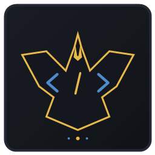
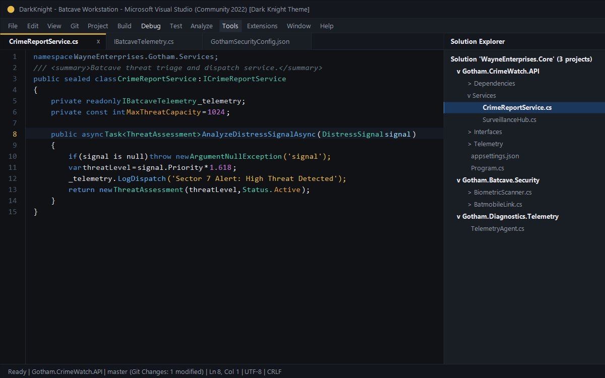
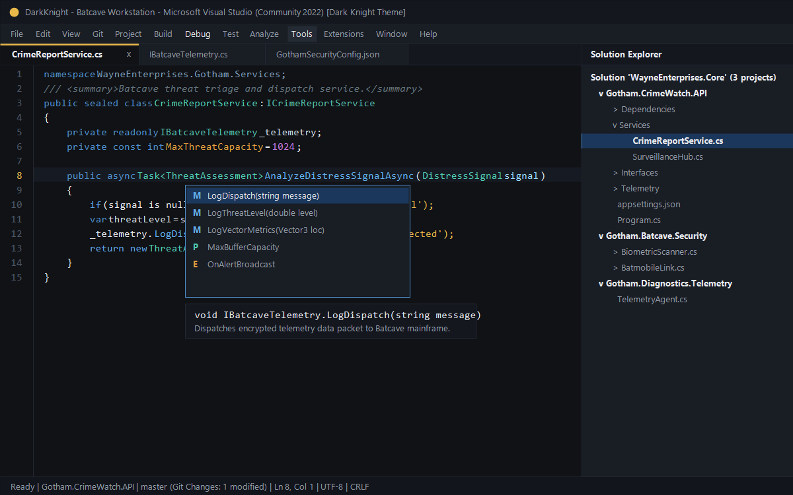
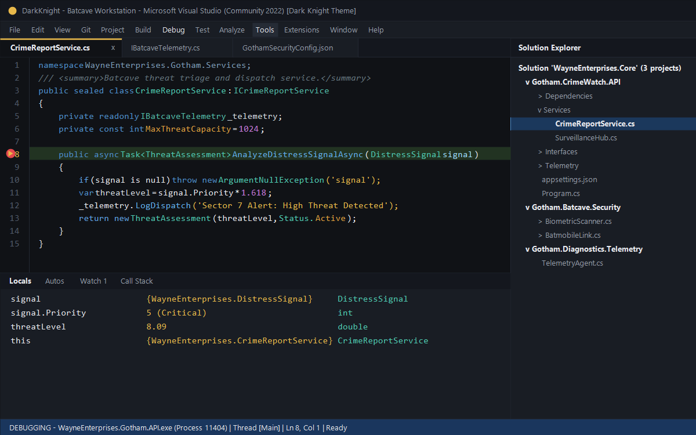
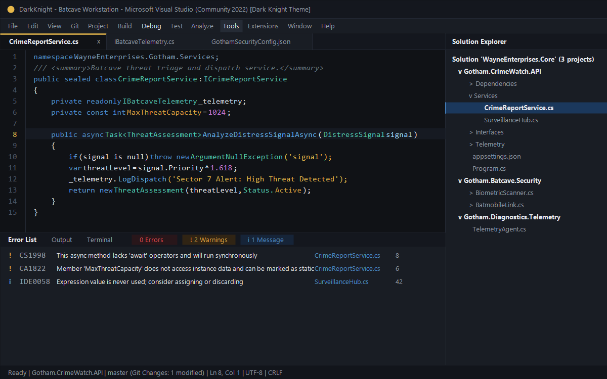

# Dark Knight — Gotham Dark Theme for Visual Studio

<p align="center">
  
</p>

<p align="center">
  <strong>A premium, cinematic Batman-inspired dark theme for the full Microsoft Visual Studio IDE.</strong><br/>
  Featuring a distinctive Batcave workstation aesthetic optimized for professional C# and .NET development.
</p>

<p align="center">
  
  
  
  
  
</p>

---

## Overview

**Dark Knight** transforms Visual Studio 2022 into a sophisticated Batcave workstation. Engineered for professional .NET developers, it replaces standard high-glare surfaces with a balanced near-black charcoal foundation, deep graphite tool windows, muted Batman gold accents, and electric Gotham blue highlights.

This is a **genuine Microsoft Visual Studio Extension (VSIX)** built with the official Visual Studio SDK, not a Visual Studio Code port. It provides deep coverage across the IDE shell, tool windows, editor canvas, Roslyn semantic colorizer, IntelliSense, debugger, and version control surfaces.

---

## Showcase & Screenshots

### 1. Code Editor & Professional C# Syntax

*High-contrast C# 12 / .NET code editor: Keywords in Gotham blue, types in cool cyan, methods in soft blue, strings in muted Batman gold, and numbers in lavender.*

### 2. Solution Explorer & Batcave Tool Windows

*Unified dark framing: Active tab featuring a Batman gold accent bar, secondary graphite tool windows, and distinct selection states.*

### 3. IntelliSense & Signature Help

*IntelliSense completion lists, Quick Info tooltips, and parameter info boxes rendered with crisp contrast.*

### 4. Interactive Debugging & Breakpoints

*Active execution pointer in Batman gold, breakpoint line highlight, Gotham blue status bar indicator, and Watch/Locals panels.*

### 5. Error List & Diagnostic Waves

*Accessible diagnostic colors: Clear red for compiler errors, warm amber for warnings, and Gotham blue for suggestions.*

---

## Color Palette & Design System

The Dark Knight palette is carefully calibrated to prevent eye fatigue during marathon coding sessions while meeting or exceeding **WCAG 2.1 AA/AAA** accessibility standards:

| Role | Hex | Purpose / IDE Element |
| :--- | :--- | :--- |
| **Primary Background** | `#101216` | Main editor canvas, document well background, terminal background |
| **Secondary Surface** | `#191D24` | Solution Explorer, Git Changes, Error List, Output window |
| **Header Surface** | `#14171E` | Title bar, tab well backdrop, tool window header captions |
| **Input / Card** | `#14171E` | Search inputs, text boxes, comboboxes, quick-find |
| **Primary Accent** | `#E8B84A` | **Muted Batman Gold**: Active tab accent bar, cursor, string literals |
| **Secondary Accent** | `#4D8DCC` | **Gotham Blue**: C# keywords, primary buttons, focus frames |
| **Control Keywords** | `#5EA1E6` | Electric Gotham blue: `if`, `else`, `return`, `await`, `async` |
| **Types & Structs** | `#4EC9B0` | Cool cyan: Classes, record structs, enums, generic types |
| **Interfaces** | `#52BAA7` | Soft mint cyan: `IServiceCollection`, `IDisposable` |
| **Methods & Calls** | `#61AFEF` | Soft blue: Method definitions and member invocations |
| **Numeric Literals** | `#C678DD` | Soft lavender: Integers, floats, decimals, booleans |
| **Comments & Docs** | `#62727B` | Muted green-gray: Code comments and XML doc text |
| **Primary Text** | `#E6E8ED` | Soft white: Plain text, local variables, operators, punctuation |
| **Secondary Text** | `#929BA8` | Cool gray: Inactive tab text, tool window labels, line numbers |
| **Selection** | `#1B385C` | Deep Gotham navy: High-contrast selection background |
| **Success** | `#38A169` | Muted emerald green: Git additions, build success |
| **Warnings** | `#E09F3E` | Warm amber: Compiler warnings, constants, escape sequences |
| **Errors** | `#E5484D` | Clear red: Compiler diagnostics, breakpoint glyphs |

---

## Full IDE Theme Coverage

The theme provides comprehensive styling across **54 Visual Studio categories**:

- **Shell & Windows:** Main IDE frame, title bar, menu bar, command surfaces, toolbars, and status bar.
- **Document Tabs:** Active document tab highlighted with a top Batman Gold accent line; inactive tabs blend smoothly into deep graphite.
- **Tool Windows:** Solution Explorer, Properties, Git Changes, Error List, Output window, Integrated Terminal, Task Runner Explorer, and Toolbox.
- **Code Editor:** Canvas background, line numbers, current line highlighting, selection, matching braces, visible whitespace, and collapsible margin indicators.
- **Language Services:** Fully optimized for C#, .NET, ASP.NET Core Razor, SQL / T-SQL, JSON, XML, HTML, CSS, JavaScript, and TypeScript.
- **IntelliSense:** Statement completion lists, parameter info, signature help, and Quick Info hover tooltips.
- **Search & Navigation:** Quick Find, Find in Files dialog, Go to All (Ctrl+T) popup, and Search Results grids.
- **Debugging:** Active statement highlight (gold arrow), breakpoint indicators, Watch, Autos, Locals, Call Stack, and Gotham blue debugging status bar.
- **Diagnostics:** Error squiggles, warning waves, and informational badges.
- **Version Control:** Git Changes pane, staged files, commit interface, and diff viewing surfaces.

---

## Installation

### Method 1: Pre-Built VSIX Package (Recommended)
1. Close all running instances of Microsoft Visual Studio 2022.
2. Navigate to the `dist` folder:
   ```
   dist\DarkKnightTheme.vsix
   ```
3. Double-click **`DarkKnightTheme.vsix`** to launch the Visual Studio Extension Installer.
4. Select your Visual Studio 2022 installation (Community, Professional, or Enterprise) and click **Install**.
5. Launch Visual Studio 2022.

### Method 2: Command-Line Installation via VSIXInstaller
```powershell
& "C:\Program Files\Microsoft Visual Studio\2022\Community\Common7\IDE\VSIXInstaller.exe" dist\DarkKnightTheme.vsix
```

### Method 3: Build from Source
If you wish to compile the VSIX package yourself:
1. Ensure the **Visual Studio extension development** workload is installed.
2. Open PowerShell as Administrator and run the build script:
   ```powershell
   .\build\build.ps1
   ```
3. The build script validates prerequisites, regenerates all theme assets, compiles the `.vstheme` into binary `.pkgdef`, invokes MSBuild, and outputs `dist\DarkKnightTheme.vsix`.

---

## Activating the Theme

After installation, activate Dark Knight in Visual Studio:

1. In Visual Studio, click **Tools** in the top menu bar.
2. Select **Theme > Dark Knight**.

*Alternatively:*
1. Go to **Tools > Options**.
2. Navigate to **Environment > General**.
3. Under **Color theme**, select **Dark Knight** from the dropdown.
4. Click **OK** to apply.

---

## Switching or Reverting Themes

- **Switching Themes:** To switch to another theme at any time, select **Tools > Theme > Dark** (or **Blue**, **Light**).
- **Restoring Font/Color Defaults:** If you have previously customized individual colors under **Tools > Options > Environment > Fonts and Colors**, click **Use Defaults** to view the Dark Knight baseline colors.
- **Uninstallation:**
  1. Open Visual Studio 2022.
  2. Navigate to **Extensions > Manage Extensions**.
  3. Under **Installed**, select **Dark Knight — Gotham Dark Theme for Visual Studio**.
  4. Click **Uninstall** and restart Visual Studio.

---

## Project Structure

```
bold-lovelace/
├── DarkKnightTheme.sln                   # Visual Studio 2022 Solution
├── dist/
│   └── DarkKnightTheme.vsix             # Distributable VSIX Package (77 KB)
├── src/
│   └── DarkKnightTheme/
│       ├── DarkKnightTheme.csproj       # VSIX Project File
│       ├── source.extension.vsixmanifest# VSIX v2 Manifest (AMD64, VS 2022)
│       ├── DarkKnight.vstheme           # XML Source Theme Definition (54 Categories)
│       ├── DarkKnight.pkgdef            # Compiled Binary Package Definition
│       ├── LICENSE.txt                  # MIT License & Trademark Notice
│       ├── Properties/
│       │   └── AssemblyInfo.cs          # Assembly Metadata
│       └── Resources/
│           ├── Icon.png                 # 128x128 Extension Icon
│           ├── Preview.png              # Marketplace Hero Preview
│           └── batcave-icon.svg         # Vector Batcave Emblem
├── assets/
│   ├── icon_256.png                     # High-Resolution 256x256 Icon
│   ├── icon.svg                         # Vector Source Icon
│   └── screenshots/
│       ├── 01_editor_csharp.png         # Editor & C# Highlighting
│       ├── 02_solution_explorer_tool_windows.png
│       ├── 03_intellisense_signature_help.png
│       ├── 04_debugger_breakpoints.png
│       └── 05_error_list_output.png
├── build/
│   ├── build.ps1                        # Master Build Script
│   ├── generate_theme.ps1               # Theme XML & PKGDEF Compiler
│   └── generate_graphics.ps1            # Icon & Preview Asset Generator
├── docs/
│   ├── COLOR_PALETTE.md                 # Complete Palette & WCAG Specifications
│   ├── ARCHITECTURE.md                  # Extensibility SDK & PKGDEF Architecture
│   └── VERIFICATION.md                  # Verification Report & Test Cases
└── README.md                            # Documentation & Marketplace Overview
```

---

## Technical Architecture & Fallback Mechanism

Visual Studio custom themes rely on a fallback inheritance model. In `DarkKnight.vstheme` and `DarkKnight.pkgdef`, the theme specifies:

```ini
[$RootKey$\Themes\{c86dec58-e31f-483a-af04-90c711aa3ba5}]
@="Dark Knight"
"Name"="Dark Knight"
"FallbackId"="{1ded0138-47ce-435e-84ef-9ec1f439b749}"
```

`{1ded0138-47ce-435e-84ef-9ec1f439b749}` is the permanent GUID of the official Visual Studio Dark Theme. This ensures:
- Any obscure or third-party tool window not explicitly styled by Dark Knight seamlessly falls back to Visual Studio Dark colors.
- Eliminates bright white or unstyled surfaces.
- Zero runtime overhead or memory consumption compared to built-in themes.

---

## Known Limitations

- **Legacy Win32 Dialogs:** A few legacy modal dialogs in Visual Studio (e.g. native COM file dialogs) are managed directly by the Windows OS and do not participate in WPF theming.
- **Third-Party Extension Brushes:** Extensions that hardcode color brushes instead of binding to Visual Studio's `VsBrushes` theme resources will display their hardcoded colors.

---

## Legal & Trademark Notice

*This theme is an independent open-source creative project inspired by the cinematic Batcave workstation aesthetic. It is not affiliated with, sponsored by, or endorsed by DC Comics, Warner Bros. Discovery, or Microsoft Corporation. All trademarks belong to their respective owners.*

---

## License

This project is licensed under the [MIT License](src/DarkKnightTheme/LICENSE.txt).
